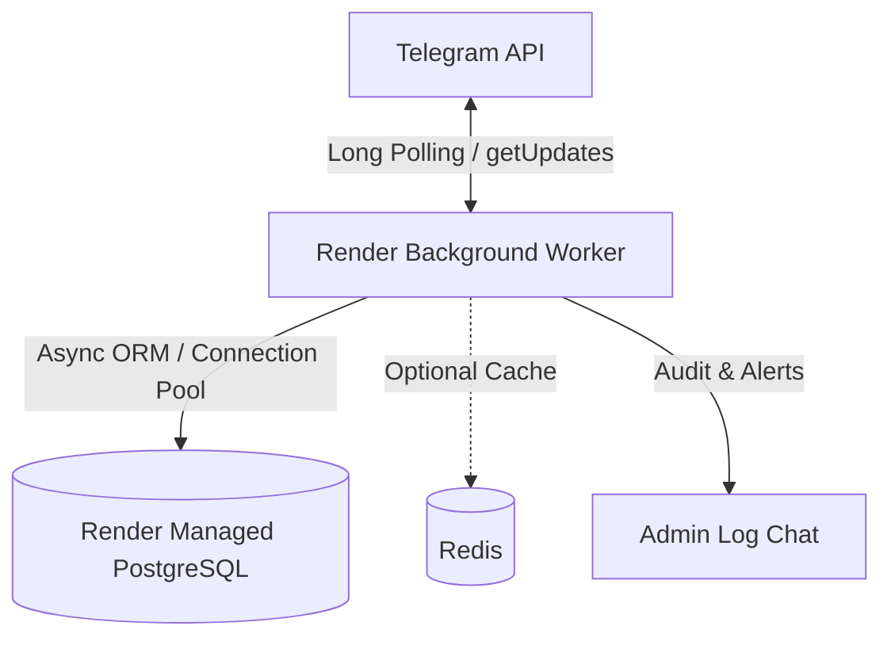

# 🚀 Deployment Guide — TG GUARD PRO V3

This guide provides instructions for deploying TG GUARD PRO V3 as a 24/7 persistent service on **Render** using a **Background Worker** and managed **PostgreSQL**.

---

## 🏗️ Architecture Overview



---

## 1. Prerequisites

1. **Telegram Bot Token:** Generated via [@BotFather](https://t.me/BotFather).
   - Ensure Group Privacy Mode is configured according to your needs (`/setprivacy` -> Disable to allow reading group messages, or make bot an administrator in groups).
2. **Owner Telegram ID:** Your numeric ID obtained via [@userinfobot](https://t.me/userinfobot).
3. **Render Account:** [dashboard.render.com](https://dashboard.render.com).
4. **GitHub Repository:** The `tg-guard-pro` private or public repository.

---

## 2. Deploying on Render (Step-by-Step)

### Option A: Using Render Blueprints (`render.yaml`) — 100% Free Tier (No Card Required)
1. In your Render Dashboard, click **New +** -> **Blueprint**.
2. Connect your `tg-guard-pro` GitHub repository.
3. Render will detect `render.yaml` configured on the **Free Plan** (`plan: free`):
   - **Web Service:** `tg-guard-pro` (Free compute with HTTP health check)
   - **Database:** `tg-guard-pro-db` (Free PostgreSQL)
4. Add the secret environment variables:
   - `BOT_TOKEN`: Your Telegram Bot API token
   - `OWNER_ID`: Your Telegram numeric user ID
   - `LOG_CHAT_ID`: Your private channel/group ID for alerts (or `0`)
5. Click **Apply** — Render will deploy without requiring any payment or credit card details.

### Option B: Manual Setup
1. **Create PostgreSQL Database:**
   - In Render, click **New +** -> **PostgreSQL**.
   - Name: `tg-guard-pro-db`
   - Region: Choose closest to your audience (e.g., Singapore / Frankfurt)
   - Plan: Free or Starter
   - Copy the **Internal Database URL** once created.
2. **Create Background Worker:**
   - Click **New +** -> **Background Worker**.
   - Connect your GitHub repository.
   - Name: `tg-guard-pro-worker`
   - Runtime: `Python 3`
   - Build Command: `pip install -r requirements.txt`
   - Start Command: `python app/main.py`
3. **Configure Environment Variables:**
   - `ENVIRONMENT` = `production`
   - `LOG_LEVEL` = `INFO`
   - `BOT_TOKEN` = `your_bot_token_here`
   - `OWNER_ID` = `your_numeric_user_id`
   - `LOG_CHAT_ID` = `your_log_chat_id`
   - `DATABASE_URL` = Paste your Render PostgreSQL URL (the app automatically converts `postgres://` to `postgresql+asyncpg://`)
   - `TIMEZONE` = `Asia/Kolkata`
   - `DEFAULT_LANGUAGE` = `Hindi`
4. Click **Create Background Worker**.

---

## 3. Verifying the Running Worker

1. Open the **Logs** tab in your Render Background Worker dashboard.
2. Look for the startup logs:
   ```text
   INFO - Initializing TG GUARD PRO V3...
   INFO - Database schema initialized and verified.
   INFO - Bot successfully authenticated as @your_bot_username (ID: 123456789)
   INFO - Starting Telegram Bot API long polling consumer...
   ```
3. Test in Telegram:
   - Send `/start` to your bot in private chat.
   - Add the bot to a test group and promote it to administrator.
   - Send `/panel` to view the 16-section interactive control dashboard.

---

## 4. Why Render Background Worker?

- **Dedicated Long Polling:** Web Services on free tiers spin down after 15 minutes of inactivity. Background Workers run continuously 24/7 without sleep.
- **Single-Consumer Polling:** Exactly one active process polls Telegram API, eliminating `Conflict: terminated by other getUpdates request` errors.
- **Graceful Shutdown:** Handles SIGINT and SIGTERM cleanly, closing connection pools and finishing pending database transactions.
